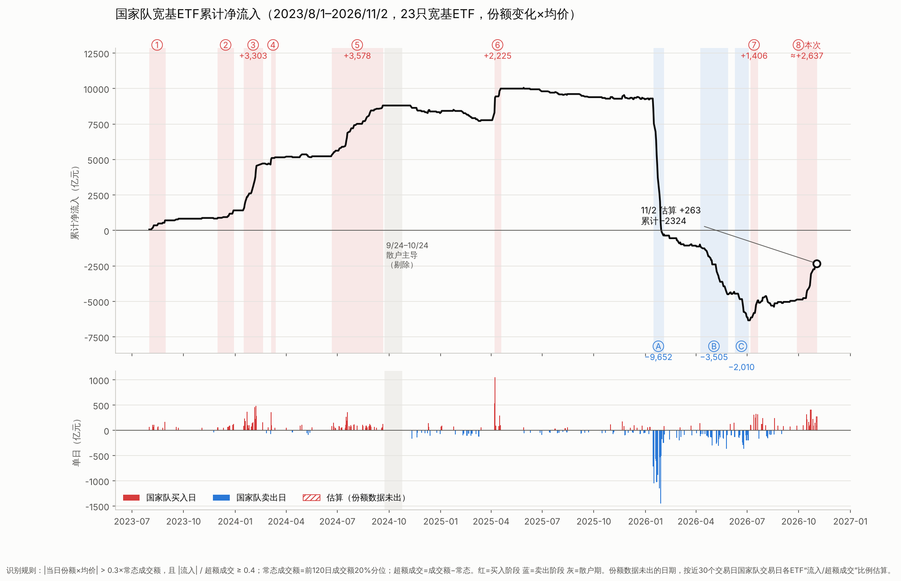

# 国家队宽基ETF资金：交叉印证与累计流入



数据：`../GJD ETF份额.xlsx`。样本为23只宽基ETF，时间从2023-08-01到2026-11-02，单位均为亿元。
更新与复现方法见文末“如何更新”。

## 1. 方法

| 步骤 | 原做法 | 现在的做法 |
|---|---|---|
| 常态成交额 | 凭感觉取“平时较低水平” | 前120个交易日成交额的 **20% 分位数**（只用过去数据），随市场活跃度变化 |
| 超额成交 | — | 超额成交 = 当日成交额 − 常态成交额 |
| 去噪 | \|流入\| ≤ 50 一律记为 0 | 两个条件**同时满足**才算国家队交易日：<br>① \|份额×均价\| > 0.3 × 常态成交额（自适应阈值，按当时的成交规模放大或缩小）<br>② \|流入\| / 超额成交 ≥ 0.4（**单向性**：成交放大的部分大多变成了申购或赎回） |
| 9/24–10/24 | sheet2 中这段被清空 | 用 `份额 均价fml` 里的原始份额和均价重新算出这段的流入（结果和 sheet2 其他日期**完全一致**，与 Wind 净流入的相关系数 0.997），只拿来做对照，**不计入国家队累计** |

条件②是区分国家队和散户的关键。国家队通常是大额单向申购，所以成交放大多少，份额就增加多少。散户成交放大时则是一边买一边卖，份额变化很小，方向还来回翻转。

阈值 0.3 只是噪音的上沿：在成交不放大的日子里，\|流入\|/常态成交额 的中位数是 0.13，75% 分位是 0.23。另外我做了敏感性测试：阈值取 0.25–0.35、单向性取 0.3–0.4，各阶段的金额变化都在 ±5% 以内。

## 2. 交叉印证：两个 sheet 是否一致

| 指标 | 国家队识别日（255 天） | 2024/9/24–10/24（18 天） |
|---|---|---|
| \|流入\| 与超额成交的相关系数 | **0.97** | 0.73 |
| \|流入\| / 超额成交（中位数） | **0.89** | 0.34 |
| 满足单向性（≥0.4）的天数占比 | 100%（按定义） | 7/18 |
| 净流入 / 总成交 | 方向一致 | 超额成交 9,466，净流入只有 1,017 |
| 方向 | 整段同向 | 10/9 前净流入，10/10 后转为连续净流出 |

结论：

- **国家队交易日在两个 sheet 上同时出现。** 除 9/24 那段外，所有超额成交 > 150 亿的日子里，\|流入\|/超额成交 大多在 0.6–1.0 之间。也就是说，成交放大的部分基本都变成了份额变化，符合“少数大资金单向申购或赎回”的特征。
- **2024/9/24–10/24 确实以散户为主。** 这一个月超额成交接近 9,500 亿，是样本里成交最热的时段之一，但份额净变化只有约 1,000 亿。10/8 成交 1,729 亿，流入只有 544 亿；10/9 之后成交仍然很高，资金却转为净流出。这是“追涨后兑现”的散户行为。2024 年 11 月和 2025 年 8–9 月也有类似的低单向性放量，新规则已经自动把这些日子排除了。
- **和原方法相比**：两种方法算出的累计曲线形状几乎一样（原方法的结果保留在 gjd_daily.csv 的 cum_user 列）。差异主要有两点：(a) 2026 年 8–10 月的小额噪音不再计入；(b) 2024 年 6–8 月“缩量慢买”期间单日 30–50 亿的买入现在能识别出来，原方法会把它们漏掉。

## 3. 11/2 估算

11/2 只有成交额数据：合计 642.8 亿，常态成交额 253.8 亿，**超额成交 389 亿**。

估算方法：本阶段国家队交易日里，每只 ETF 都有一个“流入/超额成交”的比例（沪深300 系列约 0.87–0.98，创业板约 0.56）。用这个比例乘以该 ETF 在 11/2 的超额成交，再把各 ETF 加总，得到 **约 +263 亿**；合理区间为 +150 到 +340 亿。比例取自最近 30 个交易日里的国家队交易日，由脚本自动计算。

注意事项：

- **方向是假设的。** 我延续本阶段的买入方向，因为 11/2 放量集中在 510300、512100、510500、159915，和本阶段买入的品种一致。
- **国家队最常用的两个品种 11/2 成交并不大。** 510310（易方达300）和 510330（华夏300）11/2 只成交了 11 和 13 亿，而本阶段平均是 88 和 37 亿。所以 11/2 里可能有一部分是跟风资金，应以第二天公布的份额数据为准。

## 4. 集中买卖阶段

| # | 区间 | 净额（亿） | 国家队交易日 / 交易日 | 单日均额 | 最大单日 | 流入/超额成交 | 平均成交额 |
|---|---|---|---|---|---|---|---|
| ① | 2023/8/1–8/29 | +709 | 8/21 | 89 | 167 | 0.96 | 216 |
| ② | 2023/12/1–12/29 | +577 | 7/21 | 82 | 123 | 1.02 | 173 |
| ③ | **2024/1/16–2/19** | **+3,303** | 17/19 | 194 | 485 | 0.70 | 393 |
| ④ | 2024/3/5–3/12 | +510 | 3/6 | 170 | 361 | 0.61 | 285 |
| ⑤ | **2024/6/21–9/20** | **+3,578** | 37/64 | 97 | 356 | 0.90 | 185 |
| ⑥ | **2025/4/7–4/18** | **+2,225** | 7/10 | 318 | **1,048** | 0.89 | 415 |
| Ⓐ | 2026/1/15–2/2 | **−9,652** | 13/13 | −742 | −1,452 | −0.77 | 1,125 |
| Ⓑ | 2026/4/9–5/27 | −3,505 | 22/32 | −159 | −365 | −0.65 | 360 |
| Ⓒ | 2026/6/9–7/3 | −2,010 | 11/18 | −183 | −367 | −0.60 | 393 |
| ⑦ | 2026/7/7–7/20 | +1,406 | 6/10 | 234 | 326 | 0.56 | 488 |
| ⑧ | **本次 2026/9/28–11/2** | **≈+2,637**（含11/2估算263） | 13/21 | 203 | 411 | 0.72 | 439 |

各买入阶段在不同宽基上的分布（占该阶段买入的比例）：

| 阶段 | 沪深300 | 上证50/A50/180 | 中证500 | 中证1000 | 创业板 | 科创 |
|---|---|---|---|---|---|---|
| ③ 24/1–2 | 63% | 8% | 12% | 10% | 6% | 2% |
| ⑤ 24/6–9 | 70% | 5% | 7% | 12% | 4% | 2% |
| ⑥ 25/4 | 62% | 9% | 9% | 15% | 4% | 1% |
| ⑦ 26/7 | 37% | 3% | 12% | 27% | 18% | 3% |
| ⑧ 本次 | 59% | 7% | 6% | 7% | **19%** | 2% |

### 各阶段的特点

- **③ 2024年1–2月（救市型）**：发生在小盘股流动性危机期间。成交额放大到平时的 2–3 倍，17/19 个交易日都有国家队交易，2/5–2/8 连续四天每天 225–485 亿。买入以沪深300为主，后段扩展到中证500和1000。
- **⑤ 2024年6–9月（缩量托底型）**：平均成交只有 185 亿，却累计买入 3,578 亿，是样本中**规模最大**的一段。特点是持续时间长、单日金额不大（日均约 100 亿）、几乎没有卖出（流入/超额成交 0.90）。原来 >50 的阈值会漏掉这段的不少日子。
- **⑥ 2025年4月（关税冲击，急救型）**：4/7 和 4/8 两天买入 1,584 亿，4/8 单日 1,048 亿是样本里的最高值。之后用几天小额补仓就结束了，**强度最高、持续最短**。
- **Ⓐ–Ⓒ 2026年1–7月（降温型卖出）**：1/15–2/2 连续 13 个交易日净卖出 9,652 亿，日均 −742 亿，规模约等于前面所有买入的总和。之后 4–7 月又分批卖出约 5,500 亿。累计曲线跌到 −6,300 亿，说明卖出的部分包括 2023/8 以前就持有的仓位（样本起点之前的持仓不在这份数据里）。
- **⑦ 2026年7月**：卖出阶段中途的一次反向托底，偏中证1000和创业板，买入后很快又有小规模卖出。

### 本次（⑧）的判断

1. **规模**：21 个交易日约 +2,640 亿（主体在 10/15 之后），排在第 3–4 位，接近 ③（3,303）和 ⑥（2,225），尚未达到 ⑤。如果后续按日均 200 亿左右继续买，再有 3–4 个交易日就会超过 ③。
2. **强度**：国家队交易日的日均约 203 亿，最大单日 411 亿（10/22、10/23），强于 ③ 和 ⑤，弱于 ⑥。节奏是“分批放量”：10/15–16 是第一波，10/22–26 是主攻，10/30–11/2 再度放量，比较像 ③ 那样的持续托底，而不是 ⑥ 那样一两天的急救。
3. **单向性略低**：国家队交易日的流入/超额成交为 0.76（整段 0.69），低于 ⑤ 和 ⑥ 的约 0.9。10/28、10/29 这两天放量但单向性只有 0.25–0.34，说明场内已经有较多跟风或兑现资金参与，这是和 ⑤ 那种“纯国家队行情”不同的地方。
4. **品种结构**：沪深300 仍占约 6 成，和历次一致，可以确认是同一类资金。但**创业板占 19%**，明显高于 ③⑤⑥ 的 4–6%，延续了 ⑦ 的特点，说明近期托底范围从大盘扩展到了成长板块。
5. **位置**：本次是在 2026 年上半年大规模减持之后**首次较大规模地回补**，累计曲线从 −6,300 亿回升到约 −2,300 亿。考虑到上半年卖出 ~1.6 万亿，目前回补约 4,000 亿，回补比例还不高。

## 5. 局限

- 样本只有 23 只宽基ETF，A500 等新产品不在内，所以国家队的实际规模应该更大。
- 国家队交易日的识别是统计规则，不是持仓数据。超大型机构或险资的同向操作也可能被计入。
- 2026 年的卖出包括样本起点之前的仓位，因此累计曲线为负并不代表“净卖空”。

## 如何更新

1. **更新 Excel**：在 Wind 里刷新 `GJD ETF份额.xlsx`，让 `成交额` 和 `份额 均价` 两个 sheet 都有最新日期，然后覆盖 `Documents/A股情绪/GJD ETF份额.xlsx`。
   - 如果只有成交额、份额数据还没出（比如当天收盘后），也可以直接更新。脚本会自动对这些日期做估算，图上用空心圆点和虚线标出。份额数据出来后再跑一次，估算值就会被实际值替换。
   - 9/24–10/24 那段在 `份额 均价` sheet 里留空也没关系，脚本从 `份额 均价fml` 读取原始份额和均价。
2. **运行脚本**（需要 Python 3，以及 pandas、openpyxl、matplotlib）：

```bash
cd "Documents/A股情绪/gjd_analysis"
python3 stages.py   # 打印阶段表和最近10个交易日，并写出 gjd_daily.csv、gjd_stages.csv
python3 plot.py     # 重新生成 GJD_cumulative.png
```

3. **会自动更新的内容**：国家队交易日识别、缺份额日期的估算、阶段划分和编号（买入 ①②…，卖出 ⒶⒷ…；买入 ≥500 亿、卖出 ≥1,000 亿才算一个阶段）、“本次”标记（最后一段延续到最近 5 个交易日内时），以及图上的标注和标题日期。
4. **需要手动改的**：这份 README 里的文字分析和表格不会自动更新，可以参照 `gjd_stages.csv` 改；也可以把新数据交给 Claude，让它重跑并更新分析。
